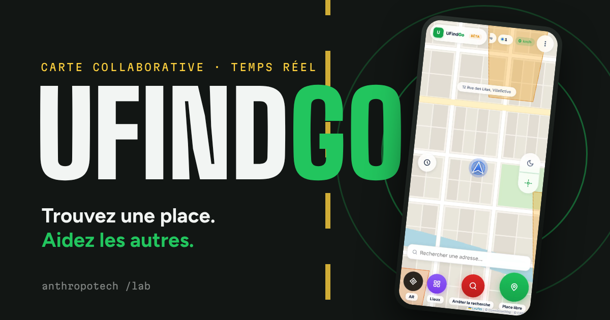

# UFindGo, page de présentation

**Trouvez une place. Aidez les autres.**

On tourne. On cherche. On tourne encore. Une place se libère à deux rues d'ici, et personne ne le sait. UFindGo fait de chaque passant un éclaireur : celui qui voit une place libre la signale d'un geste, et elle s'allume sur la carte de tous ceux qui cherchent autour.

Ce dépôt contient la page de présentation de UFindGo, carte collaborative en temps réel, gratuite, sans compte et sans publicité. L'application est en version bêta.

  
  

## Ce que présente la page

| Rubrique | Contenu |
|:--|:--|
| Le geste | Un appui sur le bouton vert : la zone de la place s'allume chez ceux qui cherchent autour, pendant cinq minutes |
| Autour de vous | 15 catégories de lieux utiles (pharmacies, distributeurs, toilettes, bornes électriques...), avec la distance à pied et l'itinéraire |
| Réalité augmentée | La caméra superpose à la rue les places signalées et les lieux choisis, avec un guidage vocal |
| Sécurité | Réservé aux passagers et aux personnes à l'arrêt : confirmation à l'ouverture et alerte au-delà de 20 km/h |
| Vos données | Position arrondie à environ 11 m, affichage de 5 minutes, effacement du serveur sous 24 heures au plus tard |

## Vos données

- Un identifiant tiré au hasard, sans lien avec l'identité de l'utilisateur.
- La position n'est partagée qu'au moment d'un signalement.
- La photo de profil reste sur le téléphone.
- Un mode local, sans aucun partage, et un bouton pour effacer toutes les données.
- Aucun compte, aucune publicité, aucun traceur.
- Les signalements partagés transitent par Google Firebase. L'adresse, les lieux proches et les itinéraires proviennent des services ouverts d'OpenStreetMap.

## Principes de la page de présentation

- Aucun cookie, aucun traceur, rien d'enregistré dans le navigateur.
- Captures réalisées avec une ville et des signalements fictifs.
- Page non référencée par les moteurs de recherche.

## Technique

Page statique en HTML, CSS et JavaScript, sans dépendance, hébergée sur GitHub Pages. Polices Big Shoulders Display, Figtree et Martian Mono sous licence SIL Open Font License 1.1 (voir `fonts/OFL.txt`).

---

UFindGo, projet d'Anthropotech Lab. Conçu et développé par Shams &amp; Dean. 
© 2026 Shams Guettaf, Anthropotech Lab. Tous droits réservés. Voir <a href="LICENSE">LICENSE</a> et les <a href="https://shamsetdean.github.io/ufindgo-presentation/mentions-legales.html">mentions légales</a>.
